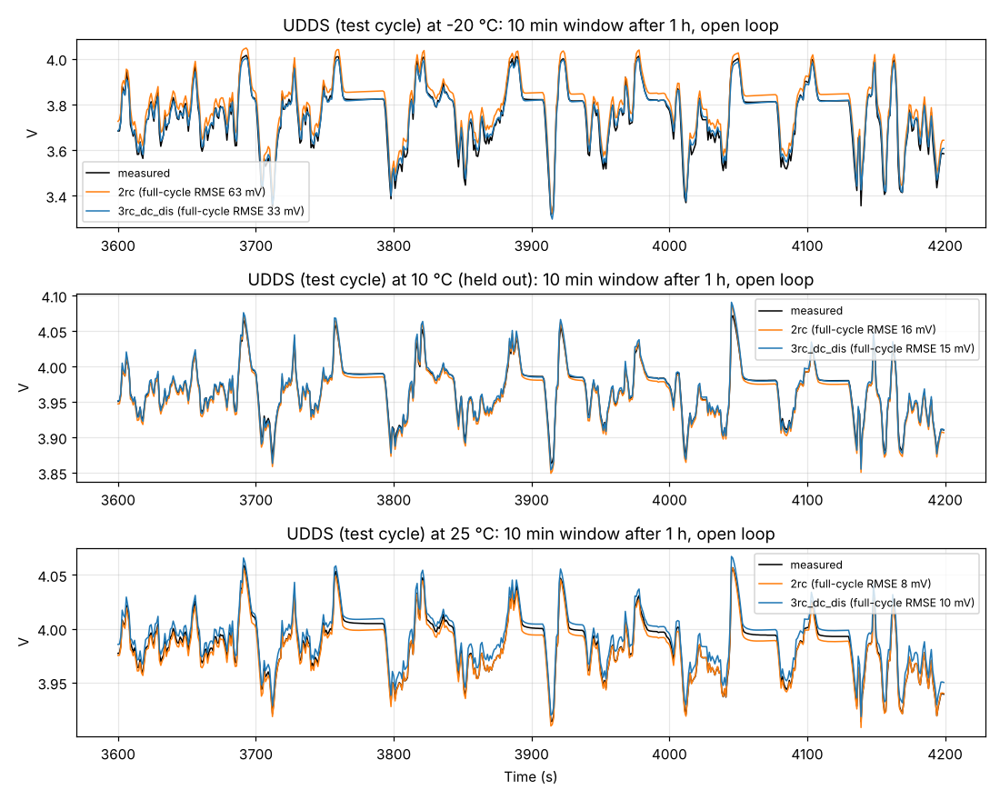

# bms-soc-estimation

Physics-based and data-driven state-of-charge (SoC) estimation for a Li-ion cell, compared fairly on public data: coulomb counting, an extended Kalman filter (EKF) on an identified equivalent circuit model, an LSTM and a small Transformer. Everything is reproducible with one command.

Self-directed project by Seyyed Ali Sadat (Western University), built to learn cell-level battery management system (BMS) methods on real data.


## Result in one table

SoC error in percentage points on test data that no estimator was fitted, calibrated, tuned or selected on. Mean over cycles.

| Estimator | RMSE, unseen cycles | RMSE, unseen temperature (10 °C) | Max error, unseen cycles | RMSE, started under load 20 points low | RMSE, +100 mA current bias | Time per 1 Hz step |
|:--|--:|--:|--:|--:|--:|--:|
| Coulomb counting | 0.11 | 0.30 | 0.18 | 19.97 | 4.62 | under 0.001 ms |
| EKF, 2RC (HPPC only) | 1.73 | 1.34 | 2.93 | 3.97 | 2.77 | 0.06 ms |
| EKF, 3RC (calibrated) | **0.76** | **1.15** | **1.50** | 2.23 | **1.63** | 0.06 ms |
| LSTM, 4,769 parameters | 1.35 | 1.42 | 4.72 | **1.50** | 1.89 | 0.22 ms |
| Transformer, 17,697 parameters | 1.62 | 1.40 | 5.93 | 1.83 | 1.95 | 0.27 ms |

The two robustness columns are on the unseen-cycle set. "Max error" is the mean over cycles of each cycle's largest error. Timing is from a cloud virtual machine (Intel Xeon, 2.30 GHz, one thread). Full tables: [results/tables/m4_summary.md](results/tables/m4_summary.md), [results/tables/m4_cost.md](results/tables/m4_cost.md).

What the numbers say:

1. **The calibrated EKF is the most accurate estimator in nominal conditions**, on unseen drive cycles and at the unseen temperature. The Transformer does not beat it anywhere in the nominal tests.
2. **The quality of the cell model decides the EKF.** With a 2RC model identified from HPPC pulses alone, the EKF reaches 3.69 points RMSE at -20 °C and loses to both networks at -20 and -10 °C. Adding a slow branch calibrated on the training drive cycles cuts that to 1.62 points.
3. **The LSTM matches or beats the Transformer with about a quarter of the parameters.** Three further Transformer variants (10 min window, noise augmentation, causal per-token training) did not improve on validation data. See [results/tables/m3_nn_selection.md](results/tables/m3_nn_selection.md).
4. **The networks recover faster from a cold start under load.** They need no initial state, so they are the best estimators when estimation starts mid-cycle with a 20-point error. At -20 °C the LSTM is also slightly ahead of the calibrated EKF (1.51 vs 1.62 points).
5. **The networks have larger peak errors**: 4.7 to 5.9 points against 1.5 for the calibrated EKF. Their estimate is noisy from sample to sample (panels C and D).
6. **Coulomb counting is near-exact here only by construction.** The reference SoC is itself coulomb counting with a known full-charge start and a laboratory current sensor. It never corrects a wrong initial SoC, and a 100 mA sensor bias costs it 4.6 points.
7. **Compute cost is not the constraint at 1 Hz.** Every estimator runs in well under a millisecond per step. The practical difference is memory: the EKF process peaks near 200 MB (Python, NumPy, pandas), the network processes near 690 MB because of the PyTorch runtime.

## Why this comparison

A cloud-connected BMS splits the work: fast state estimation at the edge, logging, monitoring and model updates in the cloud. Choosing the edge estimator needs an honest answer to three questions: how accurate is it on conditions it has not seen, how does it fail, and what does it cost to run. This repository answers them for one cell with a fixed protocol:

- one train, validation and test split for every method, by drive cycle and by temperature, never by time step;
- one held-out temperature (10 °C) that neither the cell model nor the networks ever see;
- the same 1 Hz inputs and the same robustness cases for every estimator;
- every choice (model variant, noise settings, network checkpoint) made on validation data and recorded in a table.

## Data

P. Kollmeyer, M. Naguib, M. Skells, *LG 18650HG2 Li-ion Battery Data*, Mendeley Data, V2, 2020, [doi:10.17632/b5mj79w5w9.2](https://doi.org/10.17632/b5mj79w5w9.2), CC BY 4.0. One new 3 Ah LG HG2 cell tested at McMaster University at -20, -10, 0, 10, 25 and 40 °C: HPPC, C/20 discharge and charge, 0.5C, 1C and 2C discharges, four standard drive cycles (UDDS, HWFET, LA92, US06) and eight mixed cycles per temperature, logged at 0.1 s under load.

Raw data is not committed. `data/download.py` fetches the 206 `.mat` files and `data/prepare.py` converts them to Parquet and writes [data/DATA_CARD.md](data/DATA_CARD.md), where every column, unit and statistic is computed from the files. Points worth knowing before reusing the data:

- Raw current is negative on discharge. This repository uses positive = discharge everywhere.
- Capacity is taken from the C/20 discharge at each temperature (2.49 Ah at -20 °C to 2.78 Ah at 25 °C). SoC is defined against the capacity at the cycle's ambient temperature.
- The reference SoC comes from the tester's Ah counter, starting at 1.0 after a CC-CV charge. The start is verified per cycle: the preceding file must be a charge that reached 4.2 V.
- Eight tests are excluded, each with its evidence in the data card: for example, five "40 °C" mixed cycles where the cell was at 23 to 25 °C, and one 25 °C HWFET file that contains no load.
- 62 drive cycles are usable.

### Split

| Set | Cycles | Content |
|:--|--:|:--|
| Train | 25 | Mixed1 to Mixed6 at -20, -10, 0, 25, 40 °C |
| Validation | 8 | Mixed7, Mixed8 at -20, -10, 0, 25 °C (none usable at 40 °C) |
| Test, unseen cycle | 19 | UDDS, HWFET, LA92, US06 at -20, -10, 0, 25, 40 °C |
| Test, unseen temperature | 10 | every usable cycle at 10 °C |

No 10 °C test of any kind (C/20, HPPC or drive cycle) is used to build the cell model. At 10 °C the model interpolates its OCV, parameters and capacity between 0 and 25 °C. The split is defined in one place, `src/socest/split.py`.

## Method

### Cell model

- **OCV** from the C/20 test at each temperature. The selected curve is the C/20 discharge branch corrected by the ohmic and polarisation drop at C/20, plus a small calibrated offset.
- **1RC and 2RC Thevenin models** fitted to the HPPC test by bounded nonlinear least squares, one fit per SoC level and temperature (9 to 12 levels). Fit quality on the pulses, 2RC, median voltage RMSE: 2.8 mV at 40 °C, 3.2 mV at 25 °C, rising in the cold ([results/tables/ecm_fit_rmse.md](results/tables/ecm_fit_rmse.md)).
- **Cold-temperature diagnosis.** The HPPC-only 2RC model predicts drive-cycle voltage to 17 mV at 25 °C but only 104 mV at -20 °C. The data shows two causes ([results/tables/m2_cold_diagnostics.md](results/tables/m2_cold_diagnostics.md)): a slow polarisation that a 60 s time constant cannot follow, and a pulse resistance that falls with current in the cold (191 mΩ at 0.75 A to 134 mΩ at 6 A at -20 °C).
- **What was tried.** A Butler-Volmer term and a slow branch fitted on the HPPC relaxations both improve the HPPC fit and both fail to transfer to drive cycles. A slow branch calibrated on the training drive cycles does transfer: 15 unknowns solved by bounded linear least squares, one time constant, and one thermal gain. All eleven variants and their validation scores are in [results/tables/m2_ecm_selection.md](results/tables/m2_ecm_selection.md).
- **Selected model** (on validation cycles): 2RC from HPPC plus the calibrated slow branch. Open-loop voltage RMSE on test cycles, HPPC-only 2RC against selected:

| | -20 °C | -10 °C | 0 °C | 10 °C (held out) | 25 °C | 40 °C |
|:--|--:|--:|--:|--:|--:|--:|
| 2RC, HPPC only (mV) | 104.0 | 60.5 | 27.6 | 34.7 | 16.9 | 11.1 |
| 3RC, calibrated (mV) | 39.9 | 25.8 | 27.3 | 31.3 | 12.1 | 10.0 |



### Estimators

- **Coulomb counting**: open loop, with the capacity at the starting temperature.
- **EKF** (Plett, 2004): state = SoC and the RC voltages, measurement = terminal voltage, Joseph-form covariance update. Measurement noise is set from the model's own voltage error on the training cycles at each temperature, times a scale `k_r`. `k_r` and the process noise are chosen on the validation cycles over three cases (nominal, initial SoC 20 points low, 50 mA current bias), because tuning on the nominal case alone would switch the voltage feedback off. Chosen for the selected model: `k_r` = 2, `q_soc` = 1e-4, `q_v` = 1e-3 V per step, with `P0` = diag(0.2², 0.01², ...). Grid and scores: [results/tables/m3_ekf_tuning.md](results/tables/m3_ekf_tuning.md).
- **Transformer**: two encoder layers, 32-dimensional, four heads, on the last 300 s of voltage, current and temperature at 1 Hz. The window is split into 5 s patches (60 tokens) to keep inference light. 17,697 parameters. No engineered features.
- **LSTM**: one layer, 32 hidden units, same input window. 4,769 parameters.
- Networks train on the training cycles with early stopping on the validation cycles, seed 42. Normalisation statistics come from the training cycles only, and windows never cross cycle boundaries.

### Evaluation

Metrics: RMSE, MAE and maximum absolute SoC error per cycle, reported per temperature and per drive cycle. Cases:

| Case | What changes |
|:--|:--|
| Nominal | nothing |
| Initial SoC 20 points low | estimator starts at 0.80, cell at rest |
| Late start, 20 points low | estimation starts 20 min into the cycle, under load |
| Sensor noise | white noise, 10 mV, 100 mA, 1 °C (1 σ) |
| Current bias | +100 mA on the measured current |

Nominal RMSE by temperature (points):

| Estimator | -20 °C | -10 °C | 0 °C | 10 °C (held out) | 25 °C | 40 °C |
|:--|--:|--:|--:|--:|--:|--:|
| EKF, 2RC (HPPC only) | 3.69 | 2.43 | 0.78 | 1.34 | 0.80 | 0.74 |
| EKF, 3RC (calibrated) | 1.62 | 0.59 | 0.56 | 1.15 | 0.50 | 0.45 |
| LSTM | 1.51 | 1.77 | 1.51 | 1.42 | 1.02 | 0.84 |
| Transformer | 2.02 | 1.95 | 1.69 | 1.40 | 1.18 | 1.15 |

After a late start the calibrated EKF is back within 5 points in a median of 63 s, and within 881 s in 90 % of test cycles. White sensor noise at these levels changes no estimator by more than 0.1 point.

Compute cost is measured sample by sample with the streaming estimators in `src/socest/streaming.py`, which reproduce the batch results exactly (checked by a unit test). To measure another machine, including a Raspberry Pi:

```
python experiments/m4_cost.py --label raspberry-pi
```

## Reproduce

Python 3.13 with the pinned packages in `requirements.txt`.

```
git clone https://github.com/SAS1997/bms-soc-estimation.git
cd bms-soc-estimation
pip install -r requirements.txt
python run_all.py --skip-train     # about 30 min on two cores, uses the committed network weights
python run_all.py                  # also retrains the six network candidates, about 2 h on CPU
python -m pytest -q                # unit tests
```

`run_all.py` downloads the data, builds the Parquet files and the data card, identifies and selects the cell model, tunes the EKF, selects the networks, evaluates, measures cost and draws the figure. Each step is a standalone script (list in `run_all.py`). `make results` and `make all` wrap the same two commands.

Random seeds are fixed. The model identification, EKF and evaluation are deterministic. Network training is seeded and single-threaded, but retrained weights can differ slightly between PyTorch builds and CPUs, so the committed weights are the reference for the numbers above.

## Repository layout

```
data/           download.py, prepare.py, DATA_CARD.md (no raw data)
src/socest/     ocv, ecm, params, identify, characterize, kalman, coulomb, thermal,
                estimators, streaming, metrics, resample, split, cycles, cell
src/socest/ml/  data, models, train
experiments/    m2_* cell model, m3_* EKF tuning and networks, m4_* evaluation
results/        figures, tables, characterization (identified model), models (weights)
tests/          unit tests: ECM, EKF, identification, loader, resampler, networks, streaming
run_all.py      one-command reproduction
```

## Limitations

- **One cell, new, one sample.** No cell-to-cell variation and no ageing. The model capacity and resistances would need tracking over life (state of health).
- **The reference SoC is coulomb counting.** It is accurate here because every cycle starts from a verified full charge on a laboratory tester, but it is not an independent measurement.
- **Temperature and test order are confounded.** The temperatures were tested in the order 25, 40, 10, 0, -10, -20 °C on the same cell.
- **The slow branch is calibrated on drive cycles, not on a dedicated test.** It is fitted on the same training cycles the networks use, which keeps the comparison fair, but it is an empirical correction.
- **The thermal gain is a fitted number.** Model parameters are looked up at T + g (T - T_start), an estimate of the temperature inside the cell from the single reported temperature. The best g was 1.0, the largest value tried, so it is not a measured property.
- **Two EKF settings sit at the edge of their search grid** (`q_soc`), and the score is flat nearby (2.09 to 2.23 points across the best eight settings).
- **Networks were trained with one seed**, so seed-to-seed spread is not reported.
- **The 40 °C data is incomplete**: three training cycles and no validation cycles.
- **Cost was measured on a cloud virtual machine only.** Raspberry Pi numbers are not yet in the table.
- **No UKF** and no adaptive filter were implemented.

## Next steps

- **Thermal sensing.** The largest remaining model error is in the cold, where the cell self-heats and one external temperature is a poor proxy for the temperature the electrochemistry sees. An internal temperature measurement, for example from fiber Bragg grating sensors embedded in a pack, would replace the fitted thermal gain with a measured input and allow a proper electro-thermal model.
- **Edge and cloud demo.** Run the streaming EKF on a Raspberry Pi with replayed measurements and stream estimates to a cloud dashboard, the architecture of a cloud-connected BMS. The streaming estimators are already in place.
- **Active cell balancing.** Build a small series pack from the identified cell model and compare passive and active balancing by balancing time and energy loss. Pack-level SoC estimates from this repository are the input a balancing controller needs.
- **A second cell.** Repeat on the Samsung INR21700 30T dataset from the same laboratory (same protocol) to test how each method transfers to a new cell.
- **State of health**, and a hybrid estimator that uses a network to correct the EKF's model error.

## References

- P. Kollmeyer, M. Naguib, M. Skells, "LG 18650HG2 Li-ion Battery Data," Mendeley Data, V2, 2020. doi:10.17632/b5mj79w5w9.2
- G. L. Plett, "Extended Kalman filtering for battery management systems of LiPB-based HEV battery packs: Part 3. State and parameter estimation," *Journal of Power Sources*, vol. 134, pp. 277-292, 2004.
- G. L. Plett, *Battery Management Systems, Volume I: Battery Modeling*. Artech House, 2015.
- A. J. Bard and L. R. Faulkner, *Electrochemical Methods: Fundamentals and Applications*, 2nd ed. Wiley, 2001. (Butler-Volmer equation)
- A. Vaswani et al., "Attention is all you need," *Advances in Neural Information Processing Systems*, 2017.
- Y. Nie, N. H. Nguyen, P. Sinthong, J. Kalagnanam, "A time series is worth 64 words: long-term forecasting with Transformers," *ICLR*, 2023. (patch embedding)
- E. Chemali, P. J. Kollmeyer, M. Preindl, R. Ahmed, A. Emadi, "Long short-term memory networks for accurate state-of-charge estimation of Li-ion batteries," *IEEE Transactions on Industrial Electronics*, vol. 65, no. 8, pp. 6730-6739, 2018.

## License

Code: AGPL-3.0 (see [LICENSE](LICENSE)). The dataset is the property of its authors and is distributed by them under CC BY 4.0; it is downloaded from Mendeley Data and not redistributed here.

## Citation

See [CITATION.cff](CITATION.cff). If you use this code, please also cite the dataset.
