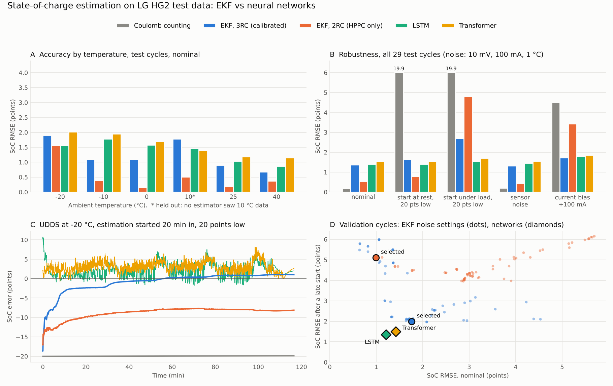
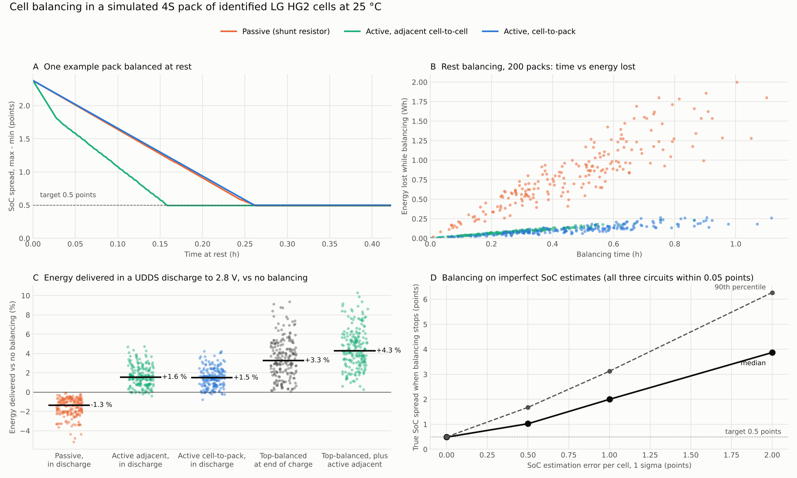

# bms-soc-estimation

Physics-based and data-driven state-of-charge (SoC) estimation for a Li-ion cell, compared fairly on public data: coulomb counting, an extended Kalman filter (EKF) on an identified equivalent circuit model, an LSTM and a small Transformer. Everything is reproducible with one command.

Self-directed project by Seyyed Ali Sadat (Western University), built to learn cell-level battery management system (BMS) methods on real data.



## Result in one table

SoC error in percentage points on test data that no estimator was fitted, calibrated, tuned or selected on. Mean over cycles.

| Estimator | RMSE, unseen cycles | RMSE, unseen temperature (10 °C) | Max error, unseen cycles | RMSE, started under load 20 points low | RMSE, +100 mA current bias | Time per 1 Hz step, Raspberry Pi 5 |
|:--|--:|--:|--:|--:|--:|--:|
| Coulomb counting | 0.11 | 0.30 | 0.18 | 19.97 | 4.62 | 0.001 ms |
| EKF, 2RC (HPPC only) | 0.55 | 0.51 | 0.89 | 6.08 | 3.46 | 0.15 ms |
| EKF, 3RC (calibrated) | 1.14 | 1.78 | 1.96 | 2.59 | 1.93 | 0.15 ms |
| LSTM, 4,769 parameters | 1.38 | 1.45 | 4.90 | **1.53** | **1.84** | 0.33 ms (ONNX Runtime) |
| Transformer, 17,697 parameters | 1.62 | 1.40 | 5.93 | 1.83 | 1.95 | 0.44 ms (ONNX Runtime) |

The two robustness columns are on the unseen-cycle set. "Max error" is the mean over cycles of each cycle's largest error. Timing is the median time per step on a Raspberry Pi 5 (8 GB), one thread; every estimator uses under 0.05 % of the 1 s sample period. Full tables: [results/tables/m4_summary.md](results/tables/m4_summary.md), [results/tables/m4_cost.md](results/tables/m4_cost.md).

What the numbers say:

1. **There is no single winner, and the nominal column is the least informative one.** The reference SoC is coulomb counting from a verified full charge with a laboratory current sensor, so under nominal conditions an estimator scores well simply by trusting current integration. Coulomb counting "wins" that column and loses every disturbance case.
2. **The networks are the most consistent estimators.** The LSTM stays between 1.4 and 1.8 points RMSE in every case on both test sets. On the validation cycles, no EKF noise setting on the tuning grid recovers from a late start as well as the networks (best 1.97 points against 1.35 and 1.49), and the settings with better nominal accuracy than the networks recover far worse (panel D).
3. **The calibrated EKF has the smallest peak errors of the closed-loop estimators**: 2.0 points on average against 4.9 to 5.9 for the networks, whose estimates are noisy from sample to sample (panel C). It is also ahead of the networks on unseen cycles in nominal conditions (1.14 against 1.38 and 1.62).
4. **The EKF loses more than the networks at the unseen temperature.** At 10 °C it must interpolate its OCV, parameters and capacity between 0 and 25 °C, and its error rises to 1.78 points. The networks, which also never saw 10 °C, stay at 1.40 to 1.45.
5. **The quality of the cell model decides whether the EKF is a closed-loop estimator at all.** With the 2RC model identified from HPPC pulses alone, the tuning turns the voltage feedback down until the filter behaves like coulomb counting: excellent nominal numbers, 6.1 points after a late start, and 6 of 29 test cycles that never return within 5 points. With the calibrated 3RC model the filter recovers in all 29 cycles (median 160 s).
6. **The LSTM matches the Transformer with about a quarter of the parameters.** Three further Transformer variants (10 min window, noise augmentation, causal per-token training) did not improve on validation data. See [results/tables/m3_nn_selection.md](results/tables/m3_nn_selection.md).
7. **EKF results are sensitive to noise tuning.** Two settings for the calibrated EKF that differ by 0.03 points on the validation objective give 1.14 and 0.76 points nominal RMSE on the unseen test cycles. The table reports the one the validation objective picked. See Limitations.
8. **Compute cost is not the constraint at 1 Hz.** Every estimator runs in well under a millisecond per step. The practical difference is memory: the EKF process peaks near 200 MB (Python, NumPy, pandas), the network processes near 690 MB because of the PyTorch runtime.

## Why this comparison

A cloud-connected BMS splits the work: fast state estimation at the edge, logging, monitoring and model updates in the cloud. Choosing the edge estimator needs an honest answer to three questions: how accurate is it on conditions it has not seen, how does it fail, and what does it cost to run. This repository answers them for one cell with a fixed protocol:

- one train, validation and test split for every method, by drive cycle and by temperature, never by time step;
- one held-out temperature (10 °C) that neither the cell model nor the networks ever see;
- the same 1 Hz inputs and the same robustness cases for every estimator;
- every choice (model variant, noise settings, network checkpoint) made on validation data and recorded in a table.

## Data

P. Kollmeyer, M. Naguib, M. Skells, *LG 18650HG2 Li-ion Battery Data*, Mendeley Data, V2, 2020, [doi:10.17632/b5mj79w5w9.2](https://doi.org/10.17632/b5mj79w5w9.2), CC BY 4.0. One new 3 Ah LG HG2 cell tested at McMaster University at -20, -10, 0, 10, 25 and 40 °C: HPPC, C/20 discharge and charge, 0.5C, 1C and 2C discharges, four standard drive cycles (UDDS, HWFET, LA92, US06) and eight mixed cycles per temperature, logged at 0.1 s under load.

Raw data is not committed. `data/download.py` fetches the 206 `.mat` files and `data/prepare.py` converts them to Parquet and writes [data/DATA_CARD.md](data/DATA_CARD.md), where every column, unit and statistic is computed from the files. Points worth knowing before reusing the data:

- Raw current is negative on discharge. This repository uses positive = discharge everywhere.
- Capacity is taken from the C/20 discharge at each temperature (2.49 Ah at -20 °C to 2.78 Ah at 25 °C). SoC is defined against the capacity at the cycle's ambient temperature.
- The reference SoC comes from the tester's Ah counter, starting at 1.0 after a CC-CV charge. The start is verified per cycle: the preceding file must be a charge that reached 4.2 V.
- Eight tests are excluded, each with its evidence in the data card: for example, five "40 °C" mixed cycles where the cell was at 23 to 25 °C, and one 25 °C HWFET file that contains no load.
- 62 drive cycles are usable.

### Split

| Set | Cycles | Content |
|:--|--:|:--|
| Train | 25 | Mixed1 to Mixed6 at -20, -10, 0, 25, 40 °C |
| Validation | 8 | Mixed7, Mixed8 at -20, -10, 0, 25 °C (none usable at 40 °C) |
| Test, unseen cycle | 19 | UDDS, HWFET, LA92, US06 at -20, -10, 0, 25, 40 °C |
| Test, unseen temperature | 10 | every usable cycle at 10 °C |

No 10 °C test of any kind (C/20, HPPC or drive cycle) is used to build the cell model. At 10 °C the model interpolates its OCV, parameters and capacity between 0 and 25 °C. The split is defined in one place, `src/socest/split.py`.

## Method

### Cell model

- **OCV** from the C/20 test at each temperature. The selected curve is the C/20 discharge branch corrected by the ohmic and polarisation drop at C/20, plus a small calibrated offset.
- **1RC and 2RC Thevenin models** fitted to the HPPC test by bounded nonlinear least squares, one fit per SoC level and temperature (9 to 12 levels). Fit quality on the pulses, 2RC, median voltage RMSE: 2.8 mV at 40 °C, 3.2 mV at 25 °C, rising in the cold ([results/tables/ecm_fit_rmse.md](results/tables/ecm_fit_rmse.md)).
- **Cold-temperature diagnosis.** The HPPC-only 2RC model predicts drive-cycle voltage to 17 mV at 25 °C but only 104 mV at -20 °C. The data shows two causes ([results/tables/m2_cold_diagnostics.md](results/tables/m2_cold_diagnostics.md)): a slow polarisation that a 60 s time constant cannot follow, and a pulse resistance that falls with current in the cold (191 mΩ at 0.75 A to 134 mΩ at 6 A at -20 °C).
- **What was tried.** A Butler-Volmer term and a slow branch fitted on the HPPC relaxations both improve the HPPC fit and both fail to transfer to drive cycles. A slow branch calibrated on the training drive cycles does transfer: 15 unknowns solved by bounded linear least squares, one time constant, and one thermal gain. All eleven variants and their validation scores are in [results/tables/m2_ecm_selection.md](results/tables/m2_ecm_selection.md).
- **Selected model** (on validation cycles): 2RC from HPPC plus the calibrated slow branch. Open-loop voltage RMSE on test cycles, HPPC-only 2RC against selected:

| | -20 °C | -10 °C | 0 °C | 10 °C (held out) | 25 °C | 40 °C |
|:--|--:|--:|--:|--:|--:|--:|
| 2RC, HPPC only (mV) | 104.0 | 60.5 | 27.6 | 34.7 | 16.9 | 11.1 |
| 3RC, calibrated (mV) | 39.9 | 25.8 | 27.3 | 31.3 | 12.1 | 10.0 |


### Estimators

- **Coulomb counting**: open loop, with the capacity at the starting temperature.
- **EKF** (Plett, 2004): state = SoC and the RC voltages, measurement = terminal voltage, Joseph-form covariance update. Measurement noise is set from the model's own voltage error on the training cycles at each temperature, times a scale `k_r`. `k_r` and the process noise are chosen on the validation cycles over four cases: nominal, initial SoC 20 points low at rest, a late start 20 points low under load, and a 50 mA current bias. Tuning on the nominal case alone would switch the voltage feedback off. Chosen for the calibrated model: `k_r` = 4, `q_soc` = 1e-5, `q_v` = 1e-4 V per step, with `P0` = diag(0.2², 0.01², ...). All 60 settings per model: [results/m3_ekf_tuning_grid.csv](results/m3_ekf_tuning_grid.csv), summary in [results/tables/m3_ekf_tuning.md](results/tables/m3_ekf_tuning.md).
- **Transformer**: two encoder layers, 32-dimensional, four heads, on the last 300 s of voltage, current and temperature at 1 Hz. The window is split into 5 s patches (60 tokens) to keep inference light. 17,697 parameters. No engineered features.
- **LSTM**: one layer, 32 hidden units, same input window. 4,769 parameters.
- Networks train on the training cycles with early stopping on the validation cycles, seed 42. Normalisation statistics come from the training cycles only, and windows never cross cycle boundaries. Six candidates were trained and one of each type was picked on the same four-case validation objective as the EKF: the plain Transformer, and the LSTM trained with added sensor noise (5 mV, 50 mA, 0.5 °C) and a random current offset, which scored 0.002 points ahead of the plain LSTM.

### Evaluation

Metrics: RMSE, MAE and maximum absolute SoC error per cycle, reported per temperature and per drive cycle. Cases:

| Case | What changes |
|:--|:--|
| Nominal | nothing |
| Initial SoC 20 points low | estimator starts at 0.80, cell at rest |
| Late start, 20 points low | estimation starts 20 min into the cycle, under load |
| Sensor noise | white noise, 10 mV, 100 mA, 1 °C (1 σ) |
| Current bias | +100 mA on the measured current |

Nominal RMSE by temperature (points):

| Estimator | -20 °C | -10 °C | 0 °C | 10 °C (held out) | 25 °C | 40 °C |
|:--|--:|--:|--:|--:|--:|--:|
| EKF, 2RC (HPPC only) | 1.56 | 0.39 | 0.15 | 0.51 | 0.19 | 0.37 |
| EKF, 3RC (calibrated) | 1.90 | 1.09 | 1.09 | 1.78 | 0.90 | 0.67 |
| LSTM | 1.56 | 1.79 | 1.58 | 1.45 | 1.03 | 0.87 |
| Transformer | 2.02 | 1.95 | 1.69 | 1.40 | 1.18 | 1.15 |

RMSE by case, mean over all 29 test cycles (panel B):

| Estimator | Nominal | Start at rest, 20 points low | Start under load, 20 points low | Sensor noise | +100 mA current bias |
|:--|--:|--:|--:|--:|--:|
| Coulomb counting | 0.18 | 19.93 | 19.89 | 0.21 | 4.49 |
| EKF, 2RC (HPPC only) | 0.54 | 0.78 | 4.79 | 0.44 | 3.44 |
| EKF, 3RC (calibrated) | 1.37 | 1.65 | 2.69 | 1.32 | 1.72 |
| LSTM | 1.41 | 1.41 | 1.53 | 1.45 | 1.79 |
| Transformer | 1.55 | 1.55 | 1.71 | 1.56 | 1.86 |

The networks have no initial state, so a wrong initial SoC at rest does not affect them. After a late start the calibrated EKF is back within 5 points in a median of 160 s, and within 1,540 s in 90 % of test cycles. White sensor noise at these levels changes no estimator by more than 0.1 point.

Compute cost is measured sample by sample with the streaming estimators in `src/socest/streaming.py`, which reproduce the batch results exactly (checked by a unit test). To measure another machine, including a Raspberry Pi:

```
python experiments/m4_cost.py --label raspberry-pi-5
```

On a device without PyTorch the networks are measured as ONNX models in ONNX Runtime, which is how they run in the edge demo below. On the cloud virtual machine ONNX Runtime halves the networks' time per step (LSTM 0.30 to 0.14 ms, Transformer 0.35 to 0.18 ms) and cuts the process's peak memory from about 680 MB to 220 MB.

On the Raspberry Pi 5 (8 GB, Raspberry Pi OS Trixie, Python 3.13, one thread):

| Estimator | ms per step, median | ms per step, 99th percentile | Peak memory of the process |
|:--|--:|--:|--:|
| Coulomb counting | 0.001 | 0.001 | 110 MB |
| EKF, 2RC (HPPC only) | 0.15 | 0.17 | 110 MB |
| EKF, 3RC (calibrated) | 0.15 | 0.17 | 110 MB |
| LSTM (ONNX Runtime) | 0.33 | 0.35 | 136 MB |
| Transformer (ONNX Runtime) | 0.44 | 0.46 | 137 MB |

The slowest estimator, the Transformer, takes under 0.5 ms of each 1,000 ms sample period, and all four together about 1 ms. Peak memory is the whole Python process, so it is mostly the interpreter and libraries.

## Edge and cloud demo (Raspberry Pi)

A small version of a cloud-connected BMS: estimation on an edge device, monitoring in the cloud. Setup guide: [demo/README.md](demo/README.md).

```
 Raspberry Pi 5                         EMQX Serverless (free)           Browser
 demo/edge.py                           MQTT broker                      docs/index.html
 replay -> EKF, LSTM, Transformer, CC   ---- MQTT over TLS, 8883 ---->   ---- secure WebSocket, 8084 ---->
 local log in demo/runs/                retained: meta, history, summary  live charts and metrics
```

- **Edge** (`demo/edge.py`): replays a test cycle one sample at a time, as if from a live cell, and runs the calibrated EKF, the LSTM, the Transformer and coulomb counting on every sample. The EKF and coulomb counting can start with a wrong SoC (20 points by default) to show recovery. Every second it publishes the new samples, estimates and per-step compute time; every 30 s a retained, downsampled history, so a viewer who opens the dashboard mid-run sees the whole run. The broker credentials stay on the device.
- **Networks without PyTorch.** The PyPI build of PyTorch for Linux ARM64 is 484 MB and depends on CUDA libraries a Pi cannot use. The selected networks are exported to ONNX (23 kB and 99 kB) and run in ONNX Runtime (a 23 MB package); the exported models reproduce PyTorch to within 5 × 10⁻⁷ SoC on every sample of a test cycle ([results/tables/m5_onnx_export.md](results/tables/m5_onnx_export.md)).
- **Data on the device.** Three test cycles at 1 Hz ship in `demo/replay/` (25 °C UDDS, -20 °C UDDS, 10 °C US06), a small attributed excerpt of the dataset under its CC BY 4.0 licence, so the Pi needs neither the raw data nor the processing pipeline.
- **Cloud** (`docs/index.html`): a static page served by GitHub Pages that subscribes with a read-only credential and plots SoC, SoC error, voltage, current and temperature, with a metrics table (RMSE, maximum error, compute time per step on the device).
- **Tested** end to end in this repository against a local MQTT broker (TCP and WebSocket listeners), with the dashboard in headless Chrome: live updates, joining mid-run, and opening after the run from retained messages. The install was rehearsed in a clean environment with only `demo/requirements-pi.txt` (no PyTorch, no dataset): 66 tests pass.
- **Run on a Raspberry Pi 5** (Raspberry Pi OS Trixie, installed from `demo/requirements-pi.txt`): 66 tests pass, and the edge loop on the 10 °C US06 cycle, with the EKF and coulomb counting started 20 points low, gives the same errors as on the development machine (RMSE 3.57 EKF, 1.72 LSTM, 1.41 Transformer, 19.78 coulomb counting) at 0.20, 0.35 and 0.45 ms per step for the EKF, LSTM and Transformer, with the CPU at 37 °C. A Pi 5 needs a supply that holds 5 V under load: a generic 5 V, 3 A USB-A adapter made it switch itself off at random; with another charger it ran normally (5.33 V measured at the board).

## Smart battery over SMBus

Most commercial packs (laptops, power tools, e-bikes, medical and industrial devices) carry a fuel-gauge chip that reports its measurements and its own SoC on the SMBus, a two-wire bus based on I2C, in the format of the Smart Battery Data Specification (SBS 1.1). This adds that input path, so the estimators can run on what a real pack reports and be compared against the pack's own gauge. Code: `src/socest/sbs.py`, `smbus_link.py`, `smart_battery_emulator.py`, `register_id.py`; tools: `demo/smbus_log.py` and `demo/edge.py --source smbus`. Full tables: [results/tables/m7_smbus.md](results/tables/m7_smbus.md).

- **Read-only by construction.** The reader implements only the SBS read protocols (Read Word, Read Block): it sends the address and a command byte, then reads. There is no write function, so it cannot change gauge settings, seal or unseal a pack, or switch its protection FETs. Replies are checked with the SMBus packet error code (PEC, CRC-8) when the gauge supports it, and failed transfers are retried.
- **Standard registers decoded** with the specification's units and scale factors (VScale, IPScale, mAh or 10 mWh capacity mode), status flags and error codes. Current is converted to this package's sign convention (positive = discharge).
- **Undocumented registers identified from data.** Gauges also put useful data (cell voltages, temperatures, counters) at manufacturer-specific codes, and the layout differs even within one vendor: code 0x3F is CellVoltage1() on the TI BQ4050 but CellVoltage4() on the BQ40Z80. `register_id.py` logs the raw words of unknown codes and fits each against the decoded standard registers and the integrals of current, reading the word as unsigned and as signed. For each code it reports which quantity it tracks, with scale, sign and offset, or that it is constant, unexplained or unanswered. This is a transparent statistical decoder, not a black box: every verdict comes with its fit.
- **Emulated pack for testing.** With no pack on the bench, an emulated SBS gauge serves the recorded test cycles byte for byte, with PEC, injected bus errors and corrupted replies, and a few vendor registers whose meaning is hidden from the decoder. Its own SoC is a simple OCV start plus coulomb counting, so it exercises the pipeline; it is not a model of a commercial gauge.

**Results on the emulated pack** (three test cycles, 1 % of transfers failing and 0.5 % of replies corrupted):

| | |
|:--|:--|
| Corrupted replies caught by PEC and re-read | 1,616 |
| Decoded values vs the recording | within SBS resolution on every sample (at most 0.5 mV, 0.5 mA, 0.05 K) |
| Reads lost after retries | 0 (308,292 successful reads) |
| Effect of SBS resolution (1 mV, 1 mA, 0.1 K) on SoC RMSE | at most 0.012 points, for any estimator and cycle |
| Vendor registers identified (quantity, scale and sign) | 48 of 48 code-cycle pairs, including a signed temperature below 0 °C |
| Bus time per 1 Hz sample on the cloud VM (emulated) | 0.3 ms median for 5 registers |

### TI BQ27426: a system-side Impedance Track gauge

The BQ27426 is a single-cell fuel gauge that sits on the device's board rather than in the pack. It runs TI's Impedance Track algorithm: OCV and resistance tables from one of three built-in chemistry profiles, coulomb counting, and learning of the cell's chemical capacity (Qmax) and resistance during use. In other words, a commercial version of this repository's physics-based approach, which makes it a natural baseline for the EKF and the networks on a live cell. `src/socest/bq27426.py` reads it; `demo/smbus_log.py --gauge bq27426` logs it; `demo/edge.py --source bq27426` streams it.

- **Different interface from a smart battery:** I2C address 0x55 and TI's own register map (Voltage, AverageCurrent, Temperature, StateOfCharge, filtered and unfiltered capacities, StateOfHealth with its Qmax learning status, Flags), not SBS, and no PEC.
- **Rate limit respected by design.** The manual says the host must not issue any standard command more than twice per second, or the gauge's watchdog can reset it. Every sample is one incremental read of registers 0x02-0x31, and the reader enforces at least 0.5 s between transfers (tested with a fake clock).
- **Read-only.** Control() subcommands need a data write and are not used. The gauge's configuration (design capacity, chemistry profile) is set with TI's tools; for a 4.2 V cell such as the LG HG2 the matching built-in profile is CHEM_B (Chem ID 1202), which is generic, not fitted to that cell.
- **Self-checks.** Each sample is checked for plausibility, and the log reports whether the current's sign agrees with the gauge's discharge flag, because the manual does not state the current's sign in words.
- **Tested on an emulated BQ27426** (register map, incremental reads, NACK above 0x6B, wrong address) built on the same recorded cycles; its SoC is not Impedance Track.

The live dashboard draws the gauge's SoC as an extra series when the source is a smart battery. On a real pack the gauge becomes the reference, and the EKF and the networks, which model an LG HG2 cell, only mean something if the pack is built from that cell; coulomb counting uses the pack's own full-charge capacity. Wiring and safety notes: [demo/README.md](demo/README.md#step-11-optional-read-a-real-smart-battery-over-smbus).

## Cell balancing (pack simulation)

A stretch goal: what passive and active balancing do for a small series pack built from the identified cell model. This is a simulation with **assumed** cell-to-cell variation; the dataset contains one cell. Code: `src/socest/pack.py`, `experiments/m6_balancing.py`. Full tables: [results/tables/m6_balancing.md](results/tables/m6_balancing.md).



**Setup.** 200 packs of 4 cells in series, each cell the selected 3RC model at 25 °C (2.78 Ah nominal). Per cell: initial SoC 0.90 + N(0, 2 points), capacity ±1.5 % (1 σ), every resistance ±5 % (1 σ), seed 7. Median initial SoC spread (max minus min) in a pack: 3.8 points. Circuits, at matched current drawn from the donor cell:

| Circuit | Model | Settings |
|:--|:--|:--|
| Passive | shunt resistor per cell, on for cells above the pack minimum | 20 Ω, about 0.2 A at 4 V |
| Active, adjacent cell-to-cell | bidirectional converter between each pair of neighbours (N - 1 converters) | 0.2 A, 85 % efficiency |
| Active, cell-to-pack | converter per cell, cells above the pack mean feed the whole string | 0.2 A, 85 % efficiency |

Topology classes follow Daowd et al. (2011) and Gallardo-Lozano et al. (2014). The converters are averaged models with constant efficiency; the 85 % and 0.2 A values are assumptions, and efficiency is swept below. Balancing decisions use SoC.

**Results.**

| | Passive | Active, adjacent | Active, cell-to-pack |
|:--|--:|--:|--:|
| Rest: time to reach 0.5 points spread (median, h) | 0.45 | 0.25 | 0.46 |
| Rest: energy lost (median, Wh) | 0.79 | 0.08 | 0.11 |
| Rest: energy lost (median, % of stored) | 2.15 | 0.22 | 0.30 |
| UDDS discharge to 2.8 V, balancing during discharge: energy delivered vs no balancing (median) | -1.3 % | +1.6 % | +1.5 % |
| String of 12 cells, rest: time (median, h) | 0.98 | 0.56 | 0.81 |

1. **Active balancing loses about a tenth of the energy of passive balancing** to equalise a resting pack (0.08 to 0.11 Wh against 0.79 Wh), at the same or shorter balancing time. Passive balancing works by burning the excess charge of every cell above the lowest one.
2. **Passive balancing during discharge makes things worse** (-1.3 % energy delivered): it drains the strong cells while the weakest cell sets the cut-off. That is why passive balancing is normally done at the end of charge.
3. **Most of the benefit here comes from where the pack is balanced, not from the circuit.** Starting the discharge top-balanced, a state any of the three circuits can reach during charging, delivers +3.3 % (median). Adding active adjacent balancing during discharge on top raises that to +4.3 %. The extra 1 point is the part only active balancing can recover: capacity mismatch, which no amount of balancing at full charge removes. With ±1.5 % capacity spread it is small; this study did not vary the capacity spread.
4. **Converter efficiency matters less than expected for discharge gain:** from 70 % to 95 % efficiency the median gain of adjacent balancing goes from +1.2 % to +1.7 %.
5. **Balancing is only as good as the SoC estimate it acts on.** If each cell's SoC estimate carries an independent error of 1 point (1 σ), every circuit stops with a true spread of about 2 points (median; 3.1 points at the 90th percentile), four times the 0.5-point target. Balancing to 0.5 points needs cell-to-cell estimation differences well below 0.5 point. Errors common to all cells, for example from the cell model or temperature, cancel here; only the differences between cells matter.

## Reproduce

Python 3.13 with the pinned packages in `requirements.txt`.

```
git clone https://github.com/SAS1997/bms-soc-estimation.git
cd bms-soc-estimation
pip install -r requirements.txt
python run_all.py --skip-train     # about 50 min on two cores, uses the committed network weights
python run_all.py                  # also retrains the six network candidates, about 2 h on CPU
python -m pytest -q                # unit tests
```

`run_all.py` downloads the data, builds the Parquet files and the data card, identifies and selects the cell model, tunes the EKF, selects the networks, exports them to ONNX, evaluates, measures cost, draws the figure and runs the balancing simulation. Each step is a standalone script (list in `run_all.py`). `make results` and `make all` wrap the same two commands.

Random seeds are fixed. The model identification, EKF and evaluation are deterministic. Network training is seeded and single-threaded, but retrained weights can differ slightly between PyTorch builds and CPUs, so the committed weights are the reference for the numbers above.

## Repository layout

```
data/           download.py, prepare.py, DATA_CARD.md (no raw data)
src/socest/     ocv, ecm, params, identify, characterize, kalman, coulomb, thermal,
                estimators, streaming, onnx_estimator, replay, metrics, resample,
                split, cycles, cell, pack, sbs, smbus_link, smart_battery_emulator,
                register_id, bq27426
src/socest/ml/  data, models, train
experiments/    m2_* cell model, m3_* EKF tuning and networks, m4_* evaluation,
                m5_* ONNX and replay export, m6_balancing pack simulation,
                m7_smbus smart-battery input path
demo/           edge node (edge.py), SMBus logger (smbus_log.py), setup guide,
                Pi requirements, replay excerpt
docs/           live dashboard (GitHub Pages)
results/        figures, tables, characterization (identified model), models (weights, ONNX)
tests/          unit tests: ECM, EKF, identification, loader, resampler, networks,
                streaming, edge node, pack and balancing circuits, SMBus path, BQ27426
run_all.py      one-command reproduction
```

## Limitations

- **One cell, new, one sample.** No cell-to-cell variation and no ageing. The model capacity and resistances would need tracking over life (state of health).
- **The reference SoC is coulomb counting.** It is accurate here because every cycle starts from a verified full charge on a laboratory tester, but it is not an independent measurement.
- **Temperature and test order are confounded.** The temperatures were tested in the order 25, 40, 10, 0, -10, -20 °C on the same cell.
- **The slow branch is calibrated on drive cycles, not on a dedicated test.** It is fitted on the same training cycles the networks use, which keeps the comparison fair, but it is an empirical correction.
- **The thermal gain is a fitted number.** Model parameters are looked up at T + g (T - T_start), an estimate of the temperature inside the cell from the single reported temperature. The best g was 1.0, the largest value tried, so it is not a measured property.
- **EKF tuning is flat and noisy.** Only eight validation cycles are available, and several noise settings score within a few hundredths of a point of each other. An earlier run of this pipeline, with three tuning cases instead of four, picked `k_r` = 2, `q_soc` = 1e-4, `q_v` = 1e-3 for the calibrated EKF. That setting scores 2.09 against 2.07 on the current validation objective, and on the test sets it gave 0.76 (unseen cycles) and 1.15 (10 °C) points nominal RMSE, 2.23 after a late start and 1.63 under current bias: better than the selected setting in every case. It is reported here for transparency and was not selected, because selecting it would use test results.
- **One protocol decision was informed by a test result.** The late-start case was added to the tuning objective after the first full evaluation showed that the 2RC filter recovered poorly under load. The change did not alter the 2RC setting; it did change the calibrated EKF's setting as described above.
- **The selected EKF settings sit at the edge of the search grid** for one parameter (`q_v`) with the calibrated model and for all three with the 2RC model.
- **Networks were trained with one seed**, so seed-to-seed spread is not reported.
- **The 40 °C data is incomplete**: three training cycles and no validation cycles.
- **Cost was measured on two machines**, a cloud virtual machine and a Raspberry Pi 5, not on a microcontroller-class BMS processor.
- **The edge demo replays recorded data.** There is no live cell or sensing hardware, and the reference SoC on the dashboard is the laboratory's.
- **The SMBus and BQ27426 paths are tested on emulated gauges only.** The protocol handling follows the specification, but timing, clock stretching, sleep modes and vendor quirks of real gauges are untested, and the emulated gauge says nothing about how a commercial fuel gauge performs.
- **No UKF** and no adaptive filter were implemented.
- **The balancing study is a simulation with assumed cell-to-cell variation**, at one temperature, with averaged converter models (constant efficiency, no switching ripple, no standby consumption) and no thermal model of the bleed resistors. It ranks the circuits and shows the mechanisms; it does not predict the numbers of a specific pack.

## Next steps

- **Thermal sensing.** The largest remaining model error is in the cold, where the cell self-heats and one external temperature is a poor proxy for the temperature the electrochemistry sees. An internal temperature measurement, for example from fiber Bragg grating sensors embedded in a pack, would replace the fitted thermal gain with a measured input and allow a proper electro-thermal model.
- **A live cell at the edge.** Run `demo/edge.py --source smbus` on a real smart battery (for example a pack built from LG HG2 cells), or connect a cell with voltage, current and temperature sensing to the Pi, so the same estimators and dashboard run on live measurements and can be compared with a commercial fuel gauge.
- **Active cell balancing on hardware.** The simulation above ranks the circuits; the next step is a prototype adjacent or cell-to-pack balancer on a small pack, driven by per-cell SoC estimates, to measure real converter efficiency and to test balancing on estimated rather than true SoC, where only cell-to-cell estimation differences matter.
- **A second cell.** Repeat on the Samsung INR21700 30T dataset from the same laboratory (same protocol) to test how each method transfers to a new cell.
- **State of health**, and a hybrid estimator that uses a network to correct the EKF's model error.

## References

- P. Kollmeyer, M. Naguib, M. Skells, "LG 18650HG2 Li-ion Battery Data," Mendeley Data, V2, 2020. doi:10.17632/b5mj79w5w9.2
- G. L. Plett, "Extended Kalman filtering for battery management systems of LiPB-based HEV battery packs: Part 3. State and parameter estimation," *Journal of Power Sources*, vol. 134, pp. 277-292, 2004.
- G. L. Plett, *Battery Management Systems, Volume I: Battery Modeling*. Artech House, 2015.
- A. J. Bard and L. R. Faulkner, *Electrochemical Methods: Fundamentals and Applications*, 2nd ed. Wiley, 2001. (Butler-Volmer equation)
- M. Daowd, N. Omar, P. Van Den Bossche, J. Van Mierlo, "Passive and active battery balancing comparison based on MATLAB simulation," *IEEE Vehicle Power and Propulsion Conference (VPPC)*, 2011.
- J. Gallardo-Lozano, E. Romero-Cadaval, M. I. Milanes-Montero, M. A. Guerrero-Martinez, "Battery equalization active methods," *Journal of Power Sources*, vol. 246, pp. 934-949, 2014. doi:10.1016/j.jpowsour.2013.08.026
- A. Vaswani et al., "Attention is all you need," *Advances in Neural Information Processing Systems*, 2017.
- Y. Nie, N. H. Nguyen, P. Sinthong, J. Kalagnanam, "A time series is worth 64 words: long-term forecasting with Transformers," *ICLR*, 2023. (patch embedding)
- Smart Battery System Implementers Forum, *Smart Battery Data Specification*, Revision 1.1, 1998.
- Texas Instruments, *BQ4050 Technical Reference Manual*, SLUUAQ3A, 2022; *BQ40Z80 Technical Reference Manual*, SLUUBT5C, 2021. (vendor register layouts)
- Texas Instruments, *bq27426 Technical Reference*, SLUUBB0, 2015.
- E. Chemali, P. J. Kollmeyer, M. Preindl, R. Ahmed, A. Emadi, "Long short-term memory networks for accurate state-of-charge estimation of Li-ion batteries," *IEEE Transactions on Industrial Electronics*, vol. 65, no. 8, pp. 6730-6739, 2018.

## License

Code: AGPL-3.0 (see [LICENSE](LICENSE)). The dataset is the property of its authors and is distributed by them under CC BY 4.0; it is downloaded from Mendeley Data and not redistributed here, except three test cycles resampled to 1 Hz in `demo/replay/`, redistributed under the same licence with attribution and a description of the changes ([demo/replay/README.md](demo/replay/README.md)).

## Citation

See [CITATION.cff](CITATION.cff). If you use this code, please also cite the dataset.
